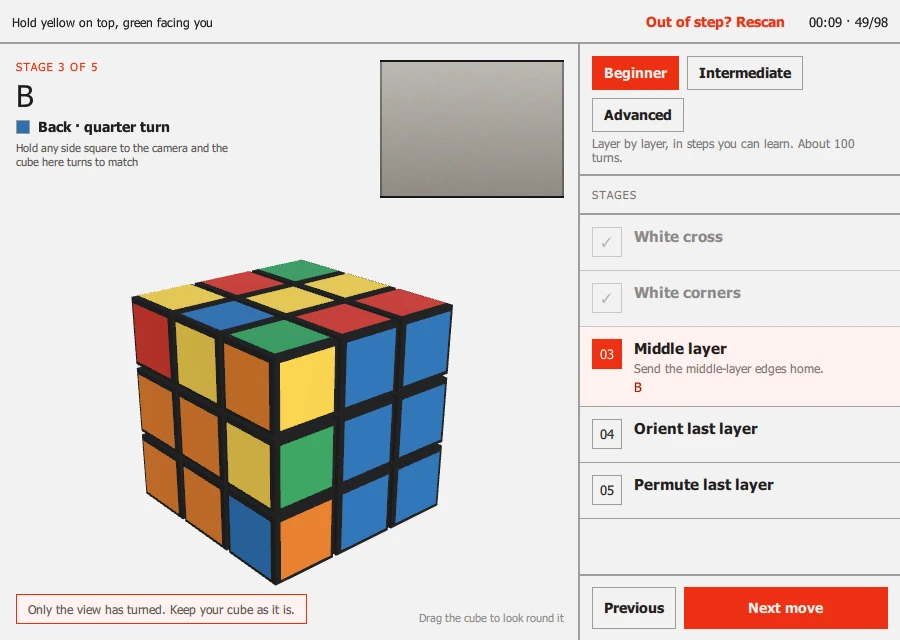

# Cubeulator

[](https://github.com/iainchesworthlabs/cubeulator/actions/workflows/ci.yml)
[](https://github.com/iainchesworthlabs/cubeulator/actions/workflows/codeql.yml)
[](https://github.com/iainchesworthlabs/cubeulator/actions/workflows/osv-scanner.yml)
[](https://github.com/iainchesworthlabs/cubeulator/actions/workflows/zizmor.yml)
[](https://scorecard.dev/viewer/?uri=github.com/iainchesworthlabs/cubeulator)
[](https://iainchesworthlabs.github.io/cubeulator/)
[](docs/architecture.md)
[](LICENSE)

A camera-driven, on-device Rubik's Cube solver: hold each side of a scrambled
cube up to the camera, and Cubeulator works out the cube, solves it, and shows
you the solution turn by turn on a 3D cube.

> **Status: pre-release.** For Windows, macOS and Linux, and in a browser. The scan has been
> checked on recorded sessions and a webcam, not yet across cameras, rooms and
> cubes, and there is no review screen yet. [CHANGELOG.md](CHANGELOG.md) says
> what each release does and what is not yet proven.

Full docs, including a
[user guide](https://iainchesworthlabs.github.io/cubeulator/guide/) with
pictures of every screen, live at
**[iainchesworthlabs.github.io/cubeulator](https://iainchesworthlabs.github.io/cubeulator/)**.

<p align="center">
  
</p>

## Install

Download the package for your system from the
[Releases page](https://github.com/iainchesworthlabs/cubeulator/releases)
(releases are pre-releases for now, so the newest is the first one listed).
You need a camera; a webcam is enough.

| Platform | Package | The first time |
| --- | --- | --- |
| Windows 10 and later, 64-bit | `Cubeulator-<version>-windows-x64.exe` | SmartScreen may say "Windows protected your PC": *More info*, then *Run anyway* |
| macOS 14.4 and later, Apple Silicon | `Cubeulator-<version>-macos-arm64.dmg` | Drag it to Applications; right-click it and choose *Open* (it is not notarised) |
| Debian, Ubuntu | `Cubeulator-<version>-linux-x64.deb` | `sudo apt install ./Cubeulator-<version>-linux-x64.deb` |
| Fedora | `Cubeulator-<version>-linux-x64.rpm` | `sudo dnf install ./Cubeulator-<version>-linux-x64.rpm` |
| A current browser | nothing to install: [open it online](https://iainchesworthlabs.github.io/cubeulator/app/), or host `Cubeulator-<version>-web.zip` yourself | needs https (or localhost) for the camera; [how it works and what it needs](docs/web.md) |

The packages are not yet signed by Microsoft or Apple, which is why Windows and
macOS ask. What each release does carry is a SHA-512 manifest, GPG signatures,
and a build-provenance attestation for every file; how to check them is in the
[security policy](docs/SECURITY.md#verifying-build-authenticity).

## Using it

1. Open Cubeulator and choose **Scan a cube**. The first time, your system
   asks whether it may use the camera: allow it.
2. Hold each side of the cube square to the camera, one after another, in any
   order, until its chip along the bottom of the screen fills. Six chips, six
   sides.
3. With six sides read, it solves the cube. The method is *Beginner* (layer by
   layer, about 100 moves) unless you changed it; switch to *Intermediate*
   (CFOP, about 50) or *Advanced* (the fewest, about 20) on the solve screen at
   any time.
4. Follow the 3D cube one turn at a time. The camera stays on, so it sees the
   side you turned and steps on by itself; **Next move** (or the right arrow)
   steps when it cannot.

The [user guide](https://iainchesworthlabs.github.io/cubeulator/guide/) goes
through each screen, and says what to do when a side will not read.

## Build from source

```sh
git clone --recurse-submodules https://github.com/iainchesworthlabs/cubeulator
cd cubeulator
./ci/install-qt.sh   # or ci/install-qt.ps1 on Windows
cmake --preset linux-gcc-debug -DCMAKE_PREFIX_PATH=$HOME/Qt/6.12.0/gcc_64
cmake --build --preset linux-gcc-debug
ctest --preset linux-gcc-debug
```

Just want the core library, no Qt/GUI?

```sh
cmake --preset linux-gcc-debug -DCUBEULATOR_BUILD_APP=OFF
cmake --build --preset linux-gcc-debug
ctest --preset linux-gcc-debug
```

See [Getting started](https://iainchesworthlabs.github.io/cubeulator/getting-started/)
for every platform's preset, including Windows/macOS, the Android/iOS targets
(build-only: neither can scan with a camera yet) and WebAssembly.

**Try it without building anything:**
[open Cubeulator in your browser](https://iainchesworthlabs.github.io/cubeulator/web/) -
the same app as WebAssembly, running entirely on your device.

## Documentation

| | |
| --- | --- |
| [User guide](https://iainchesworthlabs.github.io/cubeulator/guide/) | Installing, scanning, following the solution, settings, privacy, troubleshooting |
| [Try it in your browser](https://iainchesworthlabs.github.io/cubeulator/web/) | The app as WebAssembly: what it needs, how it differs, how it works |
| [Getting started](https://iainchesworthlabs.github.io/cubeulator/getting-started/) | Building from source: requirements, cloning, first build |
| [Building & packaging](https://iainchesworthlabs.github.io/cubeulator/building/) | Every preset, sanitizers, `cpack` |
| [Testing & coverage](https://iainchesworthlabs.github.io/cubeulator/testing/) | TDD, test layers, the 80% coverage gate |
| [Architecture](https://iainchesworthlabs.github.io/cubeulator/architecture/) | C++23 highlights, source layout |
| [Dependency strategy](https://iainchesworthlabs.github.io/cubeulator/dependency-strategy/) | vcpkg on desktop, mobile and WebAssembly |
| [Contributing](https://iainchesworthlabs.github.io/cubeulator/CONTRIBUTING/) | Branching model, code style, PR process |

## Contributing

Contributions are welcome — see
[CONTRIBUTING.md](https://iainchesworthlabs.github.io/cubeulator/CONTRIBUTING/)
for the branching model (this project follows
[gitflow](https://nvie.com/posts/a-successful-git-branching-model/):
`develop` for day-to-day work, `main` for tagged releases only) and how PRs
get reviewed. Please also read the
[Code of Conduct](https://iainchesworthlabs.github.io/cubeulator/CODE_OF_CONDUCT/).

## License

GPL-3.0-or-later. See [LICENSE](LICENSE) — and
[LICENSE-NOTE.md](LICENSE-NOTE.md) for the question of app store
distribution: the Apple stores are deferred, and it is settled before any
Apple submission.
