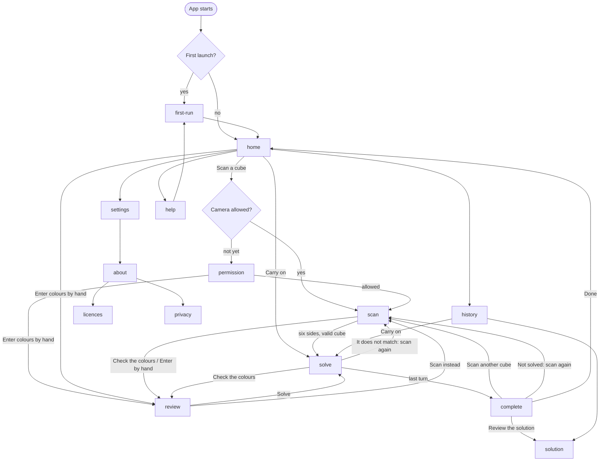

# Journey

> **Status in 0.1.0-beta.1:** This is the journey the design describes, not
> the one the app has. The app has the six screens of `Main.qml`: launch,
> permission (phones only), scan, solve, complete and settings, joined by
> `AppState.qml`. First run, review, solution, history, about, licences,
> privacy and help do not exist, so every arrow into them below is unbuilt,
> as are the back stack and Esc, the interruption handling and
> `home.resume`. What the app does have is a short loop: scan goes to solve
> by itself, solve goes to complete on **Finish** or back to scan on
> **Rescan**, and complete goes to scan again.

Every screen, every state of it, how each is entered and left, and what
"back" does. Each state has an id of the form `screen.state`. **The ids are
meant to be the inventory the system tests are checked against** (plan,
"Testing the app from its UI"). They are not yet: `tests/system/reach.cpp`
keeps its own list of the screens and states the app has, under its own
names, and fails when one of those is never visited.

Each state is specified in `screens/<screen>.md` under a heading that is its
id. `docs/design/tools/check_design.py` fails if an id here has no spec, or a
spec has no id here; CI does not run it.

Lanes: screens marked **scan** or **solve** belong to those lanes. What is
written here for them is a proposal for the chrome and the states; reading
the cube and what a move means stay theirs.

## The map

Settings and Help can also be opened from the scan screen's **More** sheet
and the solve screen's menu; back returns to where they were opened, with
the scan or the solve as it was.

## Rules that hold everywhere

1. **A way back and a way on.** Every state has a visible control that goes
   back and at least one that goes on. Platform back gestures and keys do
   the same as the visible back control; they are never the only way.
2. **Back goes where the person came from**, not to a fixed parent. The
   shell keeps a stack. Three exceptions, each to stop someone landing in a
   finished or broken place:
   - back from `complete` goes to `home`, not into the finished solve;
   - back from `solve` goes to `home` and keeps the solve (`home.resume`);
   - back from `scan` after a camera failure goes to `home`.
3. **Nothing is lost without being asked.** Leaving discards work in two
   places only, and both ask first: sides read during a scan
   (`scan.confirm-leave`) and stickers entered by hand
   (`review.confirm-discard`). A solve is kept, not discarded.
4. **A dialog's safe choice is the default**, is first in reading order,
   and is what Esc and back choose.
5. **The app starts without a camera** (lane contract). No state below
   needs one to be reached except the working scan states.

## What "back" does

| platform | back is | on `home` |
|---|---|---|
| Android | System back: the gesture or the button. Predictive back shows the screen beneath. The on-screen back control does the same | Leaves the app, as Android does by default |
| iOS | The on-screen back control at the top leading corner, and a swipe from the leading edge | Nothing; there is no back |
| Windows, Linux | Esc; Alt+Left (Alt+Right in right-to-left); the mouse back button; the on-screen back control | Nothing. Esc never closes the window |
| macOS | Esc; Cmd+[ ; the on-screen back control | Nothing |

When a dialog or sheet is open, back closes it and chooses its safe option.
On the solve screen back opens nothing and asks nothing: it goes home and
the solve is kept.

## Screens and states

### home

Lane: experience. Spec: `screens/home.md`.

| id | when | leaves to |
|---|---|---|
| `home.default` | A camera is available; nothing unfinished | **Scan a cube** > `permission.ask` or `scan.starting`. **Enter colours by hand** > `review.empty`. **History** > `history.*`. **Help** > `help.topics`. **Settings** > `settings.main` |
| `home.finding-camera` | Desktop, at start-up, while cameras are being listed | As `home.default`; becomes `home.default` or `home.no-camera` by itself |
| `home.no-camera` | Desktop; no camera was found | **Look again** > `home.finding-camera`. **Enter colours by hand** (now the primary action) > `review.empty`. Scan is shown disabled, with the reason |
| `home.camera-unsupported` | This build cannot use this device's camera: every phone until mobile capture exists | **Enter colours by hand** is the primary action. No scan control is shown, because nothing the person does would enable it |
| `home.resume` | An unfinished solve is stored. Combines with any state above | **Carry on** > `solve.hold-resume`. **Discard** > `home.confirm-discard` |
| `home.confirm-discard` | Dialog over `home.resume` | **Keep it** > `home.resume`. **Discard** > the state beneath, without the card |

Entered from: app start (after the first), back from anywhere, **Done** on
`complete`, **Not now** on `permission`.

### first-run

Lane: experience. Spec: `screens/first-run.md`.

| id | when | leaves to |
|---|---|---|
| `first-run.welcome` | First launch, before `home` has ever been shown | **Get started** > `home.*` and never shown again. **Language** > `settings.language` and back. Back (Android) leaves the app; the screen shows again next time |
| `first-run.revisit` | Opened from **Help > How it works** | **Done** or back > `help.topics` |

### permission

Lane: experience. Shown only where the operating system asks per app:
Android, iOS, macOS. Spec: `screens/permission.md`.

| id | when | leaves to |
|---|---|---|
| `permission.ask` | Camera access has not been asked for | **Allow camera** > the system's own prompt, then `scan.starting` or `permission.refused`. **Enter colours by hand** > `review.empty`. **Not now** or back > where it was opened from |
| `permission.refused` | Access was refused, or the device does not allow it | **Ask again** > the system prompt if it will still show. **Open device settings** > the system's settings; on return with access, `scan.starting`. **Enter colours by hand** > `review.empty`. **Not now** or back > where it was opened from |

Entered from: **Scan a cube** on `home`, **Scan another cube** on
`complete`, **Allow camera** in `settings.camera-refused`.

### scan

Lane: **scan** (proposal). Spec: `screens/scan.md`.

| id | when | leaves to |
|---|---|---|
| `scan.starting` | The camera is opening | Becomes `scan.settling`, or a `scan.camera-*` state |
| `scan.settling` | Exposure and colour balance are being fixed. Nothing is read | Becomes `scan.looking` |
| `scan.looking` | Running; no side read; no cube in view | Becomes `scan.in-view` |
| `scan.in-view` | A side is seen but is not steady | Becomes `scan.reading`, or back to `scan.looking` / `scan.next-side` |
| `scan.reading` | The side is steady and counting. The next chip fills | A side is read (see below), then `scan.next-side`, `scan.conflict` or `scan.complete` |
| `scan.next-side` | One to five sides read; none in view | Becomes `scan.in-view` or `scan.seen-before` |
| `scan.seen-before` | The side in view is one already read; its chip is marked | Becomes `scan.next-side` when turned away |
| `scan.stuck` | No new side for 10 seconds. A hint panel is added to whichever state is current | **Enter by hand** > `review.partial` with the sides read so far. **Help** > `help.scanning`. Clears itself when a side is read |
| `scan.conflict` | Six sides are in and do not make a valid cube | Keeps scanning: showing a side again can resolve it. **Check the colours** > `review.miscount` or `review.impossible`. **Start over** > `scan.confirm-restart` |
| `scan.complete` | Six sides make one valid cube. Held for at least 1.4 s while the solution is worked out | By itself > `solve.hold`, or `scan.solve-failed` |
| `scan.solve-failed` | The cube was read but no solution could be worked out | **Check the colours** > `review.valid`. **Scan again** > `scan.looking` |
| `scan.resuming` | The app came back to the front, or the lid was opened, mid-scan. The camera restarts; sides already read are kept | Becomes whichever state fits |
| `scan.camera-none` | No camera | **Look again** > `scan.starting`. **Enter by hand** > `review.empty`. Back > `home.*` |
| `scan.camera-busy` | Another program is using the camera | **Try again** > `scan.starting`. **Enter by hand**. Back |
| `scan.camera-blocked` | The operating system refuses access (Windows privacy settings, a Linux portal, macOS after a refusal) | **Open device settings**. **Try again**. **Enter by hand**. Back |
| `scan.camera-lost` | The camera stopped or was unplugged mid-scan. Sides read are kept | **Try again** > `scan.resuming`. **Choose a camera** > `scan.camera-picker`. **Enter by hand** > `review.partial`. Back |
| `scan.camera-failed` | Any other camera error. Shows the error code for a bug report | **Try again**. **Enter by hand**. Back |
| `scan.more` | Sheet: **Enter by hand**, **Choose a camera** (desktop, more than one), **Switch camera** (phone), **Help with scanning**, **Settings** | Each item; back closes the sheet |
| `scan.camera-picker` | Sheet listing cameras. Desktop | Choosing one > `scan.starting`. Back closes |
| `scan.confirm-leave` | Dialog. Back or **Cancel** with at least one side read | **Keep scanning** > the state beneath. **Stop** > `home.*` |
| `scan.confirm-restart` | Dialog. **Start over** with at least one side read | **Keep these** > the state beneath. **Start over** > `scan.looking` |

Events inside the screen that tests assert on but that are not states: *a
side is read* (the chip fills, a haptic tick, a screen-reader announcement
"Side 3 of 6 read").

Entered from: `home`, `permission`, `complete`, `solve.lost`,
`review` (**Scan instead**).

### review

Lane: **scan** (proposal, recovery plan R3). The same screen checks a scan
and takes a cube entered by hand. Spec: `screens/review.md`.

| id | when | leaves to |
|---|---|---|
| `review.empty` | Hand entry; only the six centres are set | Becomes `review.partial` on the first sticker |
| `review.partial` | Some stickers are unset. Shows how many are left | Becomes one of the three below when the last is set |
| `review.miscount` | Every sticker is set but some colour does not appear nine times. Names the colours that are over and under | Fixing it > `review.impossible` or `review.valid` |
| `review.impossible` | Nine of each, but no real cube looks like this | Fixing it > `review.valid` |
| `review.valid` | A valid cube. **Solve** is enabled | **Solve** > `review.working` |
| `review.working` | The solution is being worked out | By itself > `solve.hold`, or `review.solve-failed` |
| `review.solve-failed` | No solution could be worked out | **Try again** > `review.working`. **Scan instead** > `scan.starting` |
| `review.confirm-discard` | Dialog. Back with stickers entered or changed | **Keep editing** > the state beneath. **Discard** > where it was opened from |

In every state: **Scan instead** > `scan.starting` (through
`review.confirm-discard` if there are changes); **Help** > `help.entering`.

Entered from: `home` (hand entry), `scan.conflict`, `scan.stuck`,
`scan.more`, `scan.solve-failed`, any `scan.camera-*`, `solve.hold`
(**Check the colours**), `permission`.

### solve

Lane: **solve** (proposal for the chrome). Spec: `screens/solve.md`.

| id | when | leaves to |
|---|---|---|
| `solve.working` | The solution is still being worked out when the screen opens. Normally hidden behind `scan.complete` | By itself > `solve.hold`, `solve.already-solved` or `solve.failed` |
| `solve.failed` | No solution. Should not happen for a valid cube; if it does it is said plainly | **Check the colours** > `review.valid`. **Scan again** > `scan.starting`. **Home** |
| `solve.already-solved` | The cube that was read is solved | **Scan another cube** > `scan.starting`. **Home** |
| `solve.hold` | Before the first turn: how to hold the cube, with the cube as scanned | **I am holding it like this** > `solve.move`. **Check the colours** > `review.valid`. Back > `home.resume` |
| `solve.hold-resume` | The same, entered by **Carry on**: says which turn it resumes at and to check the cube matches the picture | **It matches** > `solve.move`. **It does not match** > `solve.lost`. Back > `home.resume` |
| `solve.move` | One turn is shown. Waiting for the person to make it and advance | Advance > `solve.turning`. Back one > `solve.turning` (reversed). Menu > `solve.menu`. Back > `home.resume` |
| `solve.move-hint` | `solve.move` for the first turn of a first-ever solve, with a line saying how to advance | As `solve.move` |
| `solve.turning` | The turn plays on screen. About 0.4 s; nothing with reduced motion | By itself > `solve.move`, `solve.stage-done`, `solve.last-move` or `complete.default` |
| `solve.stage-done` | Between stages: the stage just finished, a prompt to check the cube against the picture, and what the next stage does | **Carry on** > `solve.move`. **It does not match** > `solve.lost` |
| `solve.last-move` | The last turn is shown. The advance control reads **Finish** | Advance > `solve.turning` > `complete.default` |
| `solve.auto` | Timer mode: turns advance at a set pace; a bar counts down | A tap anywhere > `solve.auto-paused`. Stage ends still stop at `solve.stage-done` |
| `solve.auto-paused` | Timer mode, paused. Also where the app returns to after being in the background | **Carry on** > `solve.auto`. **Back one**. Menu |
| `solve.menu` | Sheet: **Carry on**, **How to hold the cube**, **My cube does not match**, **Settings**, **Leave this solve** | Each item. Back closes the sheet |
| `solve.lost` | The cube and the picture disagree. Says what to try, in order | **Go back one turn** > `solve.move`. **Scan the cube again** > `scan.starting` (the new scan replaces this solve). **Carry on anyway** > `solve.move` |

Entered from: `scan.complete`, `review.working`, `home.resume`,
`history.list` (an unfinished entry).

If the app is closed or killed mid-solve, the next launch shows
`home.resume`.

### complete

Lane: **solve** (chrome: experience). Spec: `screens/complete.md`.

| id | when | leaves to |
|---|---|---|
| `complete.default` | The last turn has been advanced | **Scan another cube** > `permission.ask` or `scan.starting`. **Review the solution** > `solution.overview`. **Done** or back > `home.*`. **My cube is not solved** > `complete.not-solved` |
| `complete.not-solved` | Sheet: says that a wrong turn somewhere is the usual cause, and that scanning again carries on from where the cube is | **Scan the cube again** > `scan.starting`. **Close** > `complete.default` |

### solution

Lane: experience, drawing the solve lane's cube. "Review the solution".
Spec: `screens/solution.md`.

| id | when | leaves to |
|---|---|---|
| `solution.overview` | Opened. The cube as it was scanned; the five stages with their turns | Choosing a turn or **Play** > `solution.stepping` / `solution.playing`. Back > where it was opened from |
| `solution.stepping` | A turn is selected. The cube shows the state before it | **Next**, **Previous**, **Play**. Back |
| `solution.playing` | Turns play by themselves | **Pause** > `solution.stepping`. Reaching the end > `solution.end` |
| `solution.end` | After the last turn. The cube is solved | **Start again** > `solution.overview`. Back |

Entered from: `complete.default`, `history.list`.

### history

Lane: experience. Spec: `screens/history.md`.

| id | when | leaves to |
|---|---|---|
| `history.empty` | Nothing has been solved yet | **Scan a cube** > as on `home`. Back > `home.*` |
| `history.list` | One or more solves, newest first. Unfinished ones are marked | A finished entry > `solution.overview`. An unfinished one > `solve.hold-resume`. **Delete** on an entry > `history.confirm-delete`. **Clear history** > `history.confirm-clear`. Back |
| `history.off` | Keeping history is switched off | **Open settings** > `settings.main`. Back |
| `history.confirm-delete` | Dialog | **Keep it** / **Delete** > `history.list` or `history.empty` |
| `history.confirm-clear` | Dialog | **Keep them** / **Clear** > `history.list` or `history.empty` |

### settings

Lane: experience. Spec: `screens/settings.md`.

| id | when | leaves to |
|---|---|---|
| `settings.main` | Opened | Each row. **About Cubeulator** > `about.default`. **Help** > `help.topics`. Back > where it was opened from |
| `settings.language` | The list of languages. A page on compact, a dialog on expanded | Choosing one applies it at once and returns. Back |
| `settings.camera-finding` | Desktop: cameras are being listed | Becomes `settings.camera-list` or `settings.camera-none` |
| `settings.camera-list` | Desktop: one or more cameras; one is chosen | Choosing; **Look again** |
| `settings.camera-none` | Desktop: none found | **Look again** |
| `settings.camera-allowed` | Android, iOS, macOS: access is allowed | **Open device settings** |
| `settings.camera-refused` | Android, iOS, macOS: access is refused or not yet asked | **Allow camera** > `permission.ask` |
| `settings.camera-unsupported` | This build cannot use this device's camera | Nothing to do; says so |
| `settings.confirm-clear` | Dialog: clear history | **Keep them** / **Clear** |
| `settings.developer` | Developer builds only: graphics backend, cube style, frame-rate display | - |
| `settings.restart-needed` | Developer builds: a backend was chosen that needs a restart | - |

### about, licences, privacy

Lane: experience. Specs: `screens/about.md`, `screens/licences.md`,
`screens/privacy.md`.

| id | when | leaves to |
|---|---|---|
| `about.default` | Opened from Settings, or the macOS application menu | **Licences** > `licences.list`. **Privacy** > `privacy.default`. **Source code** opens the browser. **Copy** and **Copy details** put text on the clipboard and stay here. Back |
| `licences.list` | Cubeulator's own licence and one row per third-party component | A row > `licences.detail`. Back |
| `licences.detail` | One component's notice in full | Back > `licences.list` |
| `licences.unavailable` | The generated notices could not be loaded | Says where the notices are published. Back |
| `privacy.default` | The statement: no picture is saved; history stays on this device; no internet | Back |

### help

Lane: experience. Spec: `screens/help.md`.

| id | when | leaves to |
|---|---|---|
| `help.topics` | The list of topics | A topic. **How it works** > `first-run.revisit`. Back |
| `help.scanning` | Holding the cube for the camera; light; glare | Back |
| `help.entering` | Entering the colours by hand | Back |
| `help.holding` | Holding the cube for the solve: yellow on top, green facing you | Back |
| `help.turns` | What the words mean: side, layer, turn; the six directions; quarter and half | Back |
| `help.lost` | When the cube does not match the picture | Back |
| `help.cubes` | Which cubes work and which do not | Back |
| `help.notation` | The letters, for anyone who has switched them on | Back |
| `help.keys` | Keyboard keys. Desktop only | Back |

## Interruptions

| what happens | scan | solve | elsewhere |
|---|---|---|---|
| The app goes to the background, the screen locks, the lid closes | The camera is released. On return: `scan.resuming`, sides kept | Place kept. Timer mode returns paused (`solve.auto-paused`) | As left |
| The app is killed, or the device restarts | Sides are lost; next launch is `home.*` | Next launch is `home.resume` | Next launch is `home.*` |
| A phone call or system dialog covers the app | As background | As background | - |
| The camera is unplugged | `scan.camera-lost` | No effect | `home.no-camera` when next on `home` |
| The window is resized across a size class, or the device is rotated | Layout changes; state, focus and scroll position are kept | The same | The same |
| The language, theme, text size or motion setting changes while the app is open | Applied at once, on every screen, without losing state | The same | The same |

## Journeys the system tests walk

From the plan, mapped to ids so each can be scripted:

1. **First launch to solved and round again.** `first-run.welcome` >
   `home.default` > `scan.starting` ... `scan.complete` > `solve.hold` >
   `solve.move` ... `solve.stage-done` ... `solve.last-move` >
   `complete.default` > `scan.starting`.
2. **Permission refused, then granted.** `home.default` > `permission.ask`
   > `permission.refused` > `permission.ask` > `scan.starting`.
3. **No camera.** `home.no-camera` > `review.empty` ... `review.valid` >
   `solve.hold`.
4. **Cancel mid-scan.** `scan.next-side` > `scan.confirm-leave` >
   `home.default`.
5. **A scan that does not make a valid cube.** `scan.conflict` >
   `review.miscount` > `review.valid` > `solve.hold`.
6. **Interrupted solve.** `solve.move` > (restart) > `home.resume` >
   `solve.hold-resume` > `solve.move`.
7. **Lost.** `solve.move` > `solve.menu` > `solve.lost` > `scan.starting`.
8. **Every setting changed and still set after a restart.**
9. **Language and theme switched live**, on `home`, `scan` and `solve`.
10. **Back at every screen**, by the platform's key and by the on-screen
    control.
11. All of the above **by keyboard alone**, at **compact and expanded**
    sizes, in **both themes**, in the **pseudo-locale** and in a
    **right-to-left** locale.
