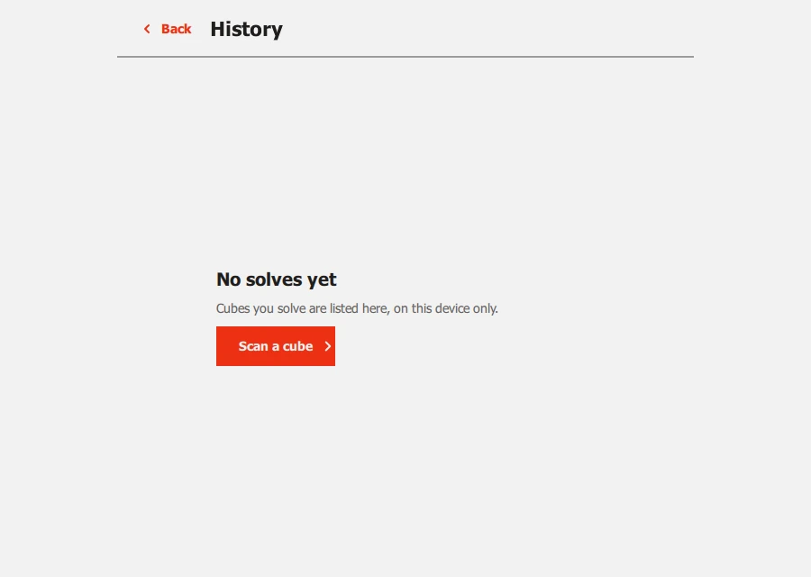

# Past solves

**History** on the start screen lists the cubes you have solved on this
device, newest first, and is the way back into one you left half-done.

<figure markdown="span">
  { loading=lazy }
  { loading=lazy }
  <figcaption>Two solves: one left part-way, one finished.</figcaption>
</figure>

Each row shows a little picture of the cube as it was scanned, when you
started, and either how many turns it took and how long (*98 turns · 00:10*) or
that it was left part-way (*Unfinished · turn 3 of 96*).

## What a row does

- **The newest unfinished solve** carries on from the turn it reached. The
  camera is off then, because nothing was scanned in this session to match it
  against, so step with **Next turn** and **Previous**; if the cube and the
  solution part company, scan again.
- **Any other row**, a finished solve or an unfinished one that you have
  since scanned past, opens its solution, to look back over it. See
  [Reviewing the solution](solve.md#reviewing-the-solution).
- **The cross** on a row deletes that solve, after asking.
- **Clear history**, at the top, deletes them all, after asking how many.
- **Back** (or <kbd>Esc</kbd>) returns to the start screen.

A solve is added to the list when you make its first move, and marked
finished when the solved screen opens. Scanning another cube while one is
unfinished leaves it in the list, unfinished, and starts a new one; only the
newest unfinished solve can be carried on.

<figure markdown="span">
  { loading=lazy }
  <figcaption>Before any cube is solved.</figcaption>
</figure>

## Turning it off

**Settings > History > Keep a history of solves** is on by default. Turning it
off stops new solves being added; it does not delete what is there (that is
**Clear history**, here or in Settings). With it off the History screen says
*History is off* and offers **Open Settings**.

## What is kept

For each solve: when it started, the cube as scanned (its colours: 54 for a
3x3, six times the size squared for another size), the turn you reached, the
number of turns and the time taken. **Never a picture.** A 3x3's solution is
not stored; it is worked out again from the cube, which gives the same
answer. A bigger cube's is stored, so a solve you carry on later is the very
one you were following, even if a newer version of Cubeulator would now find a
shorter way. The newest 100 are kept.

It is a file on your device (`solve-history.json`, in the app's data folder:
[Privacy](privacy.md#what-is-kept) says where), and nothing is sent anywhere.

## Next

[Settings and shortcuts](settings.md).
