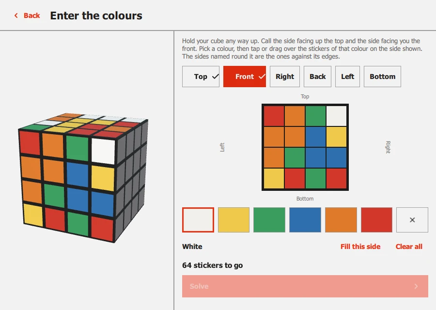

# Another size of cube

The camera reads a 3x3. For a 2x2, 4x4 or 5x5 you tell Cubeulator the cube
instead, and it works out the solution and walks you through it the same way:
a 3D cube at the right size, the layer to turn nudging, one move at a time.

<figure markdown="span">
  { loading=lazy }
  { loading=lazy }
  <figcaption>Choose a size, then give it the scramble.</figcaption>
</figure>

## Two ways to give it the cube

Choose **Another size of cube** on the start screen, then a size from 2x2 to
5x5. Then either:

- **Type the scramble.** If you mixed the cube up from a solved one, or a timer
  or a puzzle site gave you the scramble, paste it in the box and press
  **Solve it** (or <kbd>Ctrl</kbd>+<kbd>Enter</kbd>). Moves are written the way
  those sites write them: `R U R' F2` for the sides, a number first for a layer
  inside the cube (`2R` is the second layer from the right, `3L'` the third
  from the left, `2-3R` the second and third together), `w` for a wide turn
  (`Rw`, `3Rw`), and `x y z` for turning the whole cube. If something in it is
  not a move, or names a layer the cube does not have, the screen says so and
  selects it. It will not take a scramble that leaves the cube solved.
- **Enter the colours.** For a cube you have no scramble for, choose **Enter colours by
  hand**. You paint one side at a time, as you see it looking straight at
  it, and the screen names the six sides by where they are on the cube. It
  counts the colours as you go, tells you which colour has too many or too few,
  and if the colours cannot be a real cube (a corner twisted, an edge flipped,
  two stickers swapped) it says which kind of fault and outlines a sticker of
  the piece at fault. When it is a cube it can solve, **Solve** lights up.

<figure markdown="span">
  { loading=lazy }
  <figcaption>Painting a 4x4. The cube beside it is the cube as far as you have got.</figcaption>
</figure>

The camera is only for a 3x3, so with a 3x3 chosen there is also **Scan it
instead**.

## Following it

The solve screen is the one you know, with what a bigger cube needs:

<figure markdown="span">
  { loading=lazy }
  { loading=lazy }
  <figcaption>A layer inside a 5x5. The move line counts it from the side.</figcaption>
</figure>

- **Which layer.** A move of a layer inside the cube says so in words, counted
  from the side it is named for: *Right side · layer 2 · quarter turn*, or
  *layers 1 to 2* when two are turned together. The layer on the 3D cube is the
  one that nudges.
- **The stages.** A cube bigger than a 3x3 is first made to look like one:
  its centres are gathered into blocks, then its edges are paired up, and then
  what is left is solved as a 3x3 with the method you chose. The list shows the
  stages this cube needs (a 4x4 and a 6x6 may need an extra short one first so
  that the pairing cannot go wrong).
- **Skip to the 3x3.** If you can already gather centres and pair edges, press
  **Skip to the 3x3 stage** and the cube on screen jumps to the 3x3 it would
  be by then. Turn your own cube to match first, or use it as a check.
- **The method** you choose (Beginner, Intermediate, Advanced) is how that
  final 3x3 is finished, so the picker says **Finish with**.
- **A long way to go.** A 5x5 takes several hundred turns. Taking a few at a
  time, putting the cube down, and picking it up again later is what
  [History](history.md) is for: your place is kept.

There is no camera on this screen and no rescan: the cube is the one you told
it about. If your cube and the screen part company, go back and enter it
again.

## Reviewing it

**Review the solution** on the solved screen, or a finished row in History,
opens the whole solution for a cube of any size, grouped by stage, with the
cube beside it at the turn you select.

<figure markdown="span">
  { loading=lazy }
  { loading=lazy }
  <figcaption>A review part-way through a 5x5.</figcaption>
</figure>

## What is not here yet

- **The camera reads only a 3x3.** Scanning bigger cubes is planned.
- **Sizes 2 to 5.** Bigger cubes are solved by the library but are not offered
  on screen yet.
- **The words.** The new screens are in English; other languages are drafts
  that no fluent reader has been through ([Settings](settings.md#language)).

## Next

[Following the solution](solve.md), or back to [Scanning a cube](scan.md).
