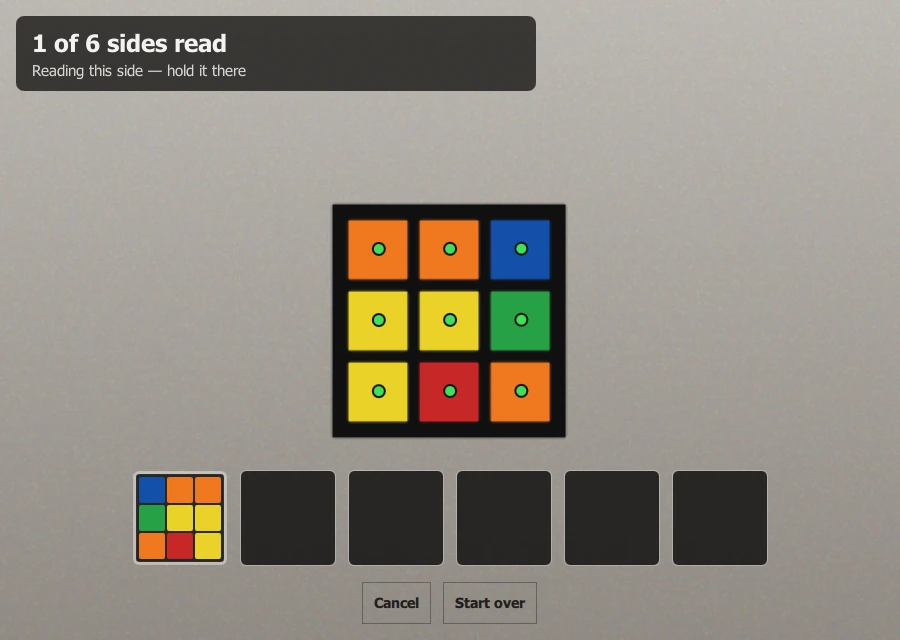
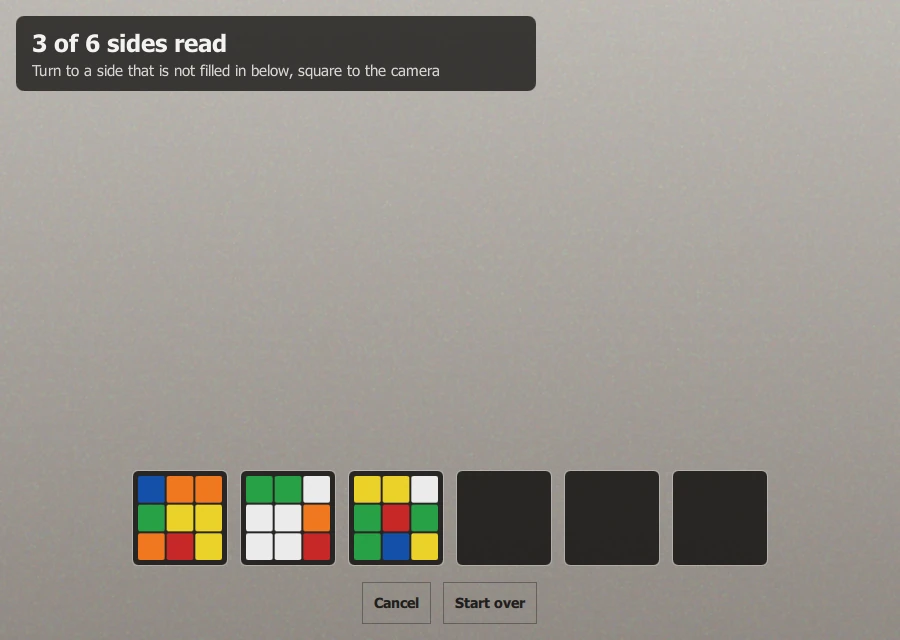
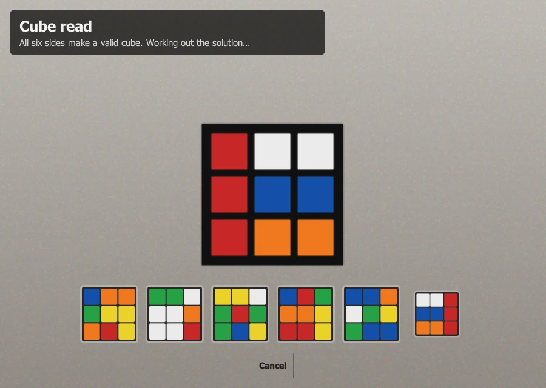
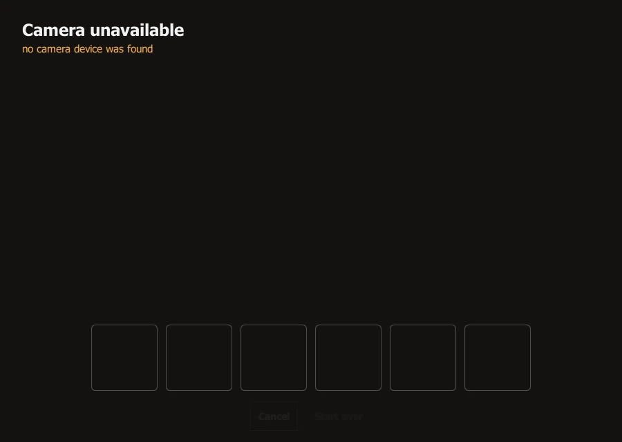

# Scanning a cube

Choose **Scan a cube** on the start screen. The camera opens, and Cubeulator
reads the cube one side at a time. You do not tell it which side is which, and
you do not type anything: each side is recognised by the colour of its centre.

!!! note "About the pictures"
    The screenshots in this guide are made by the project's test suite with
    drawn camera frames, so that nobody is in them. The grey wall and the
    drawn cube stand in for what your camera sees.

## Before you start

- Put the cube where the light falls on the side you are holding, and avoid a
  bright window or lamp behind it.
- Hold it **square to the camera**, as if you were showing it to someone: the
  side flat towards the lens, not tilted. On its own, a side seen at an angle
  is not read; the exception is a cube held on a corner, below.
- Keep your fingers off the stickers. A thumb on the edge of the cube is fine;
  a finger across a sticker makes its colour unreliable.
- Hold it close enough that the stickers are clearly visible, with the whole
  side in view.

## Reading the six sides

<figure markdown="span">
  { loading=lazy }
  <figcaption>The first side is being read. A dot sits on each of its nine
  stickers, and its chip, bottom left, is filling.</figcaption>
</figure>

1. **Hold one side up.** The top left of the screen says what it is waiting
   for. As soon as it finds a side, a yellow dot appears on each of its nine
   stickers.
2. **Hold it still.** The dots turn green while it reads, and a bar fills along
   the bottom of the next empty chip. It takes about a third of a second of
   keeping still. The chip then shows the nine colours the camera measured
   (not tidy swatches: they are the colours it actually saw).
3. **Turn to another side.** Any side, in any order, and either way up. A side
   it already has is not counted twice. The headline counts up: *1 of 6 sides
   read*, *2 of 6*, and so on.
4. **Keep going until six.** The chips fill left to right in the order you
   showed the sides.

<figure markdown="span">
  { loading=lazy }
  <figcaption>Three of six. It asks for a side that is not filled in yet.</figcaption>
</figure>

When the sixth is read, the six sides are checked against each other. If they
make exactly one cube that can exist, the chips light up green, the headline
says **Cube read**, and a moment later the solution appears.

<figure markdown="span">
  { loading=lazy }
  <figcaption>Cube read. The solution is being worked out behind this
  screen.</figcaption>
</figure>

## What the screen says

The words at the top left are the guide. In the order you will meet them:

| It says | What is happening, and what to do |
| --- | --- |
| *Starting the camera…* | The camera is opening. |
| *Setting the camera's exposure and colour balance…* | The camera is being fixed to one setting so that colours do not drift while you scan. It takes a moment. |
| *Hold one side of the cube square to the camera* | Waiting for the first side. |
| *Hold it still* | It can see a side but it is moving. Keep it steady. |
| *Reading this side — hold it there* | It is reading. Keep still until the chip fills. |
| *Turn to a side that is not filled in below, square to the camera* | That side is done; show it another one. |
| *These six sides do not make a valid cube yet. Show each side again, square to the camera.* | One or more stickers were read wrongly, or a side was counted twice. Show each side again; if it keeps saying this, use **Start over** and improve the light. |
| *Turn the cube slowly to show the corner where Yellow, Green and Red meet.* | The six sides fit together in more than one way (about one scrambled cube in eighty, and more often a patterned one). Colours named are the centres of the three sides that meet at one corner of your cube: hold that corner towards the camera, with all three sides in view, and keep it still. Seeing it settles which cube yours is. |
| *These six sides fit together in more than one way. Turn the cube slowly so that two sides show at once.* | The same, when no one corner would help more than another. Turn the cube slowly so that the camera sees two sides at the same moment. |
| *All six sides make a valid cube. Working out the solution…* | Done. |

## The buttons

- **Cancel** goes back to the start screen.
- **Start over** forgets the sides read so far and begins again. It is dimmed
  until the first side is read.
- **Try again** takes the place of *Start over* when the camera could not be
  started. It asks for the camera again, so once whatever was in the way is
  sorted you do not have to go back to the start screen.
- **Check the colours** appears once six sides are in. It opens the colours the
  camera read, side by side, so that you can put right whatever it got wrong
  instead of scanning again: see [When the camera misreads a
  colour](troubleshooting.md#when-the-camera-misreads-a-colour).

## If the camera will not open

The screen says **Camera unavailable** and gives the reason, for example *no
camera device was found* or *the camera could not be started*. Another program
may be using the camera, or the system may be blocking it. Sort that out (see
[Troubleshooting](troubleshooting.md#the-camera-does-not-open)), then press
**Try again**.

<figure markdown="span">
  { loading=lazy }
  <figcaption>Camera unavailable, with <strong>Try again</strong> to ask for
  the camera once more.</figcaption>
</figure>

## Holding a corner to the camera

A cube held on a corner shows two or three sides in one picture, and the scan
uses that. A side of such a view counts as a read of that side when it has
held still, most of its nine stickers are in view, and it is not seen too
edge-on. Holding one corner and then the corner across from it can read all
six sides, and it is how a cube that six flat sides leave in doubt is
settled.

It is the newer of the two ways and the less proven: showing one side square
to the camera at a time is still the reliable one. No dots are drawn on a
corner view, and the screen's words still say *this side*; watch the chips
fill. In poor light the third side of a corner is often missed, and the scan
carries on with the sides it did read.

## How it tells the sides apart

Each side is identified by what is on it, not by where it is. The centre
sticker never moves on a real cube, so six distinct centres name six distinct
sides, and the colours around them say how they are placed. The six sides are
then tried in every way up until exactly one cube that can exist is left; that
check is also what tells red from orange under a warm bulb, where their hue
alone is only a few degrees apart. The details are in the
[Vision pipeline](../vision-pipeline.md).

## Next

[Following the solution](solve.md).
