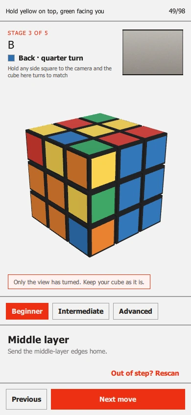
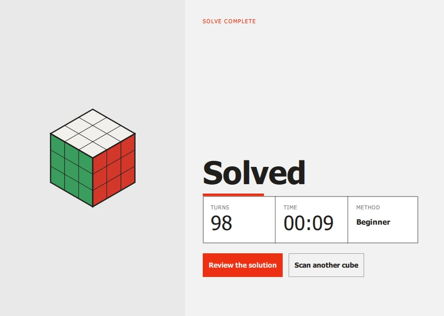

# Following the solution

When the scan is done, the solve screen shows your cube in 3D, exactly as it
stands, and walks you through the turns that solve it. You do not need to read
cube notation: the layer to turn moves on the picture, and the screen says it
in words as well.

<figure markdown="span">
  { loading=lazy }
  { loading=lazy }
  <figcaption>The first move. The top layer is nudged the way it has to go.</figcaption>
</figure>

## Hold the cube the way the screen says

Every move is named for a side *as you are holding the cube*, so the first
thing to do is hold it like the picture. The line along the top says how:

> Hold yellow on top, green facing you

The colours are the centres of the sides, which never move. Turn your cube so
the side with that centre is on top and the other is towards you, and the 3D
cube on screen is the cube in your hands.

You do not have to get it exactly right. Once the camera has seen the cube, the
line changes to *Holding yellow on top, green facing you*, and the 3D cube
turns to match however you are actually holding it (see
[the camera](#the-camera-follows-you) below).

## One move at a time

For each move, the top left of the screen shows:

- **The stage** you are in, for example *Stage 3 of 5*.
- **The move**, in notation (`U'`, `B`, `R2`), and under it in words with the
  centre colour of the side: *Top · quarter turn*, *Right side · half turn*.
  A bare letter is a clockwise quarter turn looking straight at that side, a
  prime (`'`) is anticlockwise, and `2` is a half turn.
- **The layer on the cube** nudging a little way in the direction it has to go
  and back (twice, for a half turn).

Make that turn on your cube, then press **Next turn**. The cube on screen
turns the layer the whole way so you can see it land, and the next move is
shown. **Previous** takes the last move back, on screen; turn your cube back
too.

The same keys step too: **Right arrow**, **Space** or **Enter** for the next
move and **Left arrow** for the previous one.

<figure markdown="span">
  { loading=lazy }
  { loading=lazy }
  <figcaption>Half way. The stages are listed on the right, with the finished
  ones ticked. The move is on the back, so the view has swung round behind the
  cube.</figcaption>
</figure>

### Moves on the back

A move on the side facing away from you turns out of sight. For those, the
view swings round behind the cube, and a note says **Only the view has turned.
Keep your cube as it is.** It is the picture that has moved, not an instruction
to turn your cube over. The view swings home afterwards.

You can also look round yourself: drag the cube with the mouse or a finger, and
let go to bring it home.

## Stages

A solution is divided into stages, each with a plain description. For the
Beginner method they are:

| Stage | What it does |
| --- | --- |
| White cross | Brings the four white edges home, matching each side's centre. |
| White corners | Inserts the four white corners to complete the first layer. |
| Middle layer | Sends the middle-layer edges home. |
| Orient last layer | Orients the last layer's edges and corners so the top reads solid. |
| Permute last layer | Moves the last layer's pieces into their solved places. |

On a wide window every stage is listed on the right, the finished ones ticked
and the current one opened out; on a narrow window only the current stage is
shown.

<figure markdown="span">
  { loading=lazy width="320" }
  <figcaption>The narrow layout, which is also what a phone's browser shows.</figcaption>
</figure>

## Three ways to solve it

The row of buttons at the top of the right-hand panel picks the method:

| Method | In short | About how many turns |
| --- | --- | --- |
| **Beginner** | Layer by layer, in steps you can learn. | 100 |
| **Intermediate** | The way fast solvers do it (CFOP), in four stages. | 50 |
| **Advanced** | The fewest turns there are, with no stages to learn. | 20 |

Beginner is the default. You can change method at any moment, including
half-way: the cube is solved *from where it stands now*, with whatever you have
done kept. The method you choose is remembered for the next cube. It can also
be set in [Settings](settings.md). Each method works out its answer in about a
second or less. How they work is in [Solve methods](../solver-methods.md).

## The camera follows you

The camera stays on while you solve, and the small picture in the top right
corner is what it sees. It does two things:

- **It turns the 3D cube to match how you are holding yours.** Show it any side,
  square on, and the cube on screen turns to the same hold.
- **It steps on by itself when you make the move.** When the side it sees fits
  the cube *after* the move that was asked for, the solution moves on without a
  button press. A move on the side that faces you cannot be seen turning, so for
  those the screen says to press **Next turn**.

The frame round the picture is the camera's verdict:

| Frame | It means |
| --- | --- |
| Green | The side in view is the one expected: *Matched to your cube*. Make the move and it steps on by itself. |
| Amber | *That side looks the same turned. Show another to tell which way up.* |
| Red | It is not what the solution has. The screen says what it saw instead. |

If you turn the wrong side, a note says so: for example *The red side was
turned, but not the way shown. Turn it back and try again*, or *The blue side
(Right side) was turned instead. Turn it back, then make the move shown.* The
buttons still work, and the solution never moves on by itself while the cube
and the solution disagree.

Sometimes it is simplest to start again from where you are: **Out of step?
Rescan** (top of the screen on a wide window, above the buttons on a narrow
one) reads the cube again as it now is and solves it from there. Anything
already done stays done.

If the cube you scanned was not the cube you have (a sticker read as the wrong
colour that still made a real cube), **Check the colours**, over the buttons at the
bottom, shows what the camera read so that you can put it right by hand; see [When
the camera misreads a
colour](troubleshooting.md#when-the-camera-misreads-a-colour). **Solve** there
starts a new solution from the first turn, and **Back** returns to this one.

## Finishing

On the last move, the **Next turn** button changes to **Finish**. Press it, and
the screen says **Solved**, with the number of turns and the time it took.

<figure markdown="span">
  { loading=lazy }
  <figcaption>The solved screen. The numbers here are from a test run.</figcaption>
</figure>

**Scan another cube** goes straight back to the scan. **Review the solution**
opens [the whole solution](#reviewing-the-solution). Either way the solve is
kept in your [history](history.md).

## Reviewing the solution

**Review the solution** on the solved screen (or a finished solve in your
[history](history.md)) lists every turn, grouped by stage, with what each
stage does and why, beside a cube that shows the position *before* the turn
you have selected.

<figure markdown="span">
  { loading=lazy }
  { loading=lazy }
  <figcaption>The solution, part-way through.</figcaption>
</figure>

- **Previous** and **Next** step one turn, and the cube turns the layer so
  you can see it. **Play** runs the turns one after another; it becomes
  **Pause**, and **Start again** at the end.
- **Tap a row** to jump to that turn.
- The keys do the same: the arrow keys, <kbd>Space</kbd> to play and pause,
  <kbd>Home</kbd> and <kbd>End</kbd> for the first turn and the solved cube.
- **Back** (or <kbd>Esc</kbd>) returns to where you came from.

It keeps its own place, so looking back over a solve never moves the solve
you are in the middle of.

## Next

[Past solves](history.md), then [Settings and shortcuts](settings.md).
