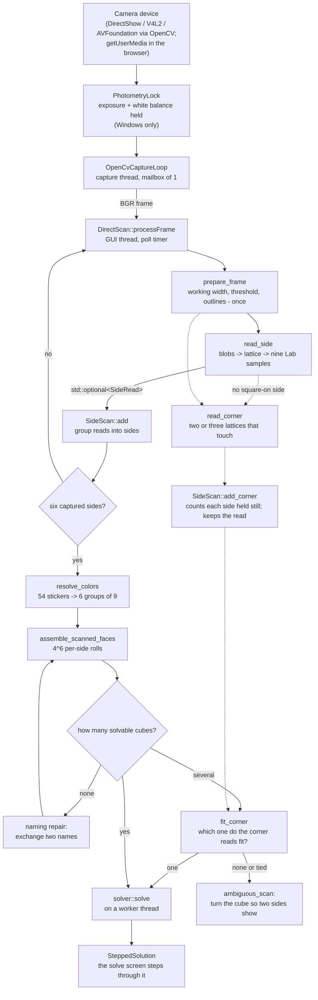

# Vision pipeline

How a camera frame becomes a solved cube. This documents what the code does
**today**: the cube is read one side at a time, from whichever side is held
square to the camera, with no pose tracker and no learned model in the way.

Why it is built this way, and what it replaced, is in
[recovery-plan.md](recovery-plan.md). The short version: the earlier pipelines
tracked the cube's six-degree-of-freedom pose before reading a single sticker,
and a cube looks identical under 24 rotations, so pose alone never says which
side is which. A side is identified here by what is on it.

Source: `src/lib/src/vision/` (platform-free, Qt-free; the cube assembly it
calls is `src/lib/src/solver/scan_assembly.cpp`), driven by
`src/app/qt/controllers/direct_scan.cpp` (Qt, GUI thread).

## End-to-end flow

## The reader: `read_side`

`cube::vision::read_side(const cv::Mat& bgr)` returns a `SideRead` or nothing.
It needs a side held roughly square to the camera and relies on darker plastic
between and around the stickers; a side seen at an angle, a lattice that does
not span three rows and three columns, or no cube all return nothing.

1. **Sticker blobs.** `prepare_frame` (`cube/vision/prepared_frame.hpp`)
   reduces the frame to the working width (640 pixels), takes the maximum
   channel as the value image, blurs it, thresholds it adaptively and traces
   the outlines. It is done once per frame and handed to both readers,
   because it is most of what a read costs; contours that are roughly square
   and roughly sticker-sized survive `read_side`'s shape test.
2. **Lattice.** The sticker pitch comes from nearest-neighbour distances and
   the direction from the folded angles. An affine least-squares fit places a
   3x3 lattice through the blobs, and the fit must span all three rows and
   columns, with at least six of the nine stickers found as blobs. Stickers
   that were not found as blobs (a finger across one) are placed by the fit
   and flagged in `SideRead::found`.
3. **Colour.** Each of the nine places is sampled from a square patch 0.6 of
   a sticker spacing across, in float CIELAB, by `sticker_lab`
   (`cube/vision/sticker_colour.hpp`, shared with `read_corner`). The colour is
   the densest cluster of the patch's pixels and the median of what lies
   near it, not the plain per-channel median: a Rubik's cube's white centre has
   a wordmark in four colours across its middle, exactly where a patch is laid,
   and a median is dragged towards it (13 Lab units, almost all lightness, over
   84 recorded reads) and fails outright once the logo is half the patch. The
   plastic is the densest cluster for as long as it is the largest single
   colour in the patch, which holds past half the patch being logo. A patch
   with no cluster of a quarter of its pixels falls back to the median.

Nothing in the reader names a colour. It returns measured Lab.

## Sides: `SideScan`

`SideScan::add` is fed every analysed frame, including frames with no read.

- A read **counts** only if the lattice has held still: the centre sticker
  moved less than `kSteadyFraction` (0.12) of a sticker spacing since the
  previous frame. A moving side is blurred and its colours are not trusted.
  That is a distance per frame, and what it guards against is a speed: a side
  turned about the cube's middle has its centre 1.5 spacings from the axis, so
  0.12 is 4.6 degrees a frame - 137 degrees a second at 30 frames a second, 100
  at 22 (what the recorded lamplight sessions ran at), 46 at 10. `add` is
  therefore told how long it was since the frame before (the capture time the
  controller has), and the allowance grows with it, to four times
  (`interval_scale`); with no time given it is the nominal 33 ms.
- A counting read joins the **group** it belongs to, or starts a new one.
  The deciding sticker is the **centre**, which never moves, and a cube's six
  centres are six distinct colours: a read whose centre is within
  `kSameColourLab` (10 Lab units, plain Lab with lightness at full weight) of
  a group's centre belongs to it, whatever a hand covers - up to
  `kMostStickersAHandCovers` (4) of the other eight differing; more than that
  is another side whose centre happens to read the same. Where the centre
  cannot vouch, the other eight stickers must: every one within
  `kSameColourLab` of the group's. Of the groups a read could join, the one
  it fits best takes it. Groups that turn out to be one side, a side that was
  begun on a noisy read or lit differently for a moment, are merged after each
  read, the earlier surviving. `kSameColourLab` sits just under
  `kMinCentreSeedSeparationLab` (12) on purpose: two centres `resolve_colors`
  refuses as one colour are still two sides here, so the refusal is reported
  instead of the scan waiting for a sixth side.
- The **quarter-turn** that lays a read on a group is the one that fits the
  eight stickers other than the centre best, each distance capped so a finger
  over one sticker cannot decide it, and a group keeps the turn it last had
  unless another beats it by `kRollPriorMargin` (one differing sticker's
  worth).
- This replaced a mean of `colour_distance` over all nine stickers under 12.
  `colour_distance` counts lightness and chroma for a quarter of what hue
  does, so red and orange, which differ almost only in lightness under a warm
  lamp, scored under 10 a sticker even with every one of them traded, and two
  sides of a partly solved cube were fused into one (2026-10-14).
- A group is **captured** once it has `kMinReads` (8) reads, about a third of a
  second of holding still.
- When more than six groups are captured (a stray lattice, a side re-captured
  under changed light) the six with the most reads are used.

## Naming and assembly

Once six sides are captured:

1. `resolve_colors` clusters the 54 Lab samples into six groups of nine,
   seeded from the six centres (a real cube has six distinct centre colours),
   and names each cluster by nearest reference colour. Because the cube's own
   stickers define the clusters, a lighting shift that moves every sample of
   one colour together cancels out.
2. `assemble_scanned_faces` finds the slot for each side from its centre and
   tries the 4,096 roll combinations against `Cube::from_facelets` and
   `is_solvable`. Physical validity is the arbiter, not a score.
3. If the naming does not assemble, the pairs of names are exchanged one pair
   at a time; among the exchanges that do assemble the one whose two centres
   look most alike is taken. This repairs red/orange swaps under tungsten light,
   which colour naming alone cannot get right.

`SideScan::scanned()` also returns what each colour measured in this session
(`SessionColours`), which the solve screen's held-cube matching compares
against.

## Two sides in one view: `read_corner` and `fit_corner`

Six square-on reads say what is on each side but not which way up each is
relative to its neighbours. For about one scrambled cube in eighty (12 of
1000 25-move scrambles) that leaves two valid cubes, and a perfect read still
cannot choose: `assemble_all_scanned_faces` returns both and the scan reports
`ambiguous_scan`, which the screen words differently from a misread.

A cube turned between sides, or held corner-on, shows two sides at once, and
where they meet the stickers along the shared edge are neighbours - the fact
the flat reads lack.

1. **`read_corner`** takes the same prepared outlines with a looser shape
   test (a side at an angle is a parallelogram: a compact four-cornered
   contour, not a square), and finds up to three 3x3 lattices. It tries each
   blob as the origin with every pair of its near neighbours (at most eight)
   as the two axes - a hypothesis-and-test search over blob triples, not
   random sampling. Every distinct 3x3 window of six or more blobs that a
   hypothesis makes is a candidate (the best 24 by blobs, then fit), and the
   sides are the set of two or three **disjoint** windows of which most meet
   another, then with the most blobs, then the tightest fit. It was greedy -
   the window with the most blobs, then the best of what was left - and two
   sides at much the same angle, which is the middle of every quarter-turn of
   a tumble, look like one grid: a window across their shared edge holds as
   many blobs as either side and fits as well, and taking it first left six
   blobs and three, no lattice and no read. Each lattice is fitted by least
   squares with its steps turning clockwise so the side reads unmirrored. Two
   lattices share an edge when two corners of each coincide; read as seen from
   outside, they walk that edge in opposite directions, which is also a check.
   It runs only on frames that have no square-on read, and gives up on a scene
   with fewer than 12 or more than 48 blobs. `read_corner_explained` says how
   far a frame got (`CornerStage`), which is what `cube_scan funnel` prints.
2. **`fit_corner`** asks whether a candidate cube could have produced the
   read, in the session's own colours: each lattice's centre names the cube
   side it is; each side's nine colours must match that side under some
   quarter-turn; and for each shared edge the side across the edge, in the
   turn that matched, must be the other lattice's side, with the stickers
   along it paired as the cube has them (checked on 3D sticker positions
   from the solver's own layout, not drawn by hand).
3. **`SideScan`** keeps one corner read of each view - the same sides seen
   again from a neighbouring angle replace it only if they are better (more
   stickers found, then the less foreshortened) - up to 64. A slow tumble shows
   one pair for a second, and the newest 48 reads were the last pair
   repeated, with the views that told the cubes apart pushed out. Six sides
   make up to 256 cubes weighed (more than that is not chosen among: the true
   one may be one not weighed; two real cubes make 20 and 32, and a cube
   one turn from solved up to 20, two half-turns 112). A cube is chosen when
   it misses at most one edge's worth of the views that fit any cube and the
   next misses at least two more: a read that fits none is a blurred frame and
   counts for no one, one that fits them all says nothing, and a three-sided
   read weighs its three edges. A winner on a count of three views of seven was
   not the cube. No pose is estimated anywhere in this.
4. **Counting.** A cube held on a corner shows two or three sides in one
   frame, so each side of a corner read is also a read of that side, counted
   the way a square-on read is (`SideScan::add_corner`): the side must have
   held still since the previous frame, have 7 or more of its 9 stickers
   found (not placed by the fit) and not be a strip (one step at least 0.45 of
   the other). It joins the side whose nine colours are nearest under some
   quarter-turn, within the same-side distance, or starts one. Three sides
   are captured in the time it takes one, and two corners - a corner and the
   one across from it - are all six. This is in addition to the square-on
   scan, not instead of it: the same side read both ways is one side, and once
   a side has `kMinReads` square-on reads of its own its colours come from
   those alone, because a side at an angle is lit a little differently. A
   side at an angle that fits no side, but is one of them lit differently
   (`shaded_view_of`: nine colours within `kCornerFitDistance` of it under
   `colour_distance`, the loose measure), starts none: it was a second group
   of its own, reached `kMinReads`, took one of the six places, and made the
   scan "six sides that make no cube" - a verdict that costs up to 150 ms on
   every frame.
   `reads_in_view()` is the fewest among the sides in view, which is the one
   the capture is waiting for.

5. **Asking for the corner that settles it.** When six sides make several
   cubes and the corner reads so far cannot choose, the scan names the corner
   to show (`AssemblyTrace::settling_corner`). Among the candidates the corner
   reads miss least, it takes the corner of the eight whose three sides differ
   between the most pairs of them - a corner view shows every sticker of its
   three sides, so two cubes are told apart there when any of them differs -
   and says it by the colours of the three centres. The scan screen asks for
   that (`DirectScan.settlingCorner`, `scan.guide.ambiguousCorner`: "Turn the
   cube slowly to show the corner where Yellow, Green and Red meet") and falls
   back to "two sides at once" when no corner would help. Following it one
   corner at a time settles the recorded patterned cube (twenty cubes from six
   sides) in at most three views, in the tests.

A cube tumbled in front of the camera, which no recording is, is what
`cube_tumble_sim` draws, and `cube_scan funnel` replays: a cube turned about
the vertical and then the horizontal shows two sides between every two
square-on views, where neither is within 30 degrees of square and neither is
more than 63 - a third of each quarter-turn, ten frames a pair at 60 degrees a
second and 30 frames a second. Drawn, the two recorded patterned cubes are
read exactly at 30 to 120 degrees a second at 30 frames a second and at 30 to
60 at 10, and 63 more, whose six flat sides make 2 to 112 cubes, at 60 and 30
([the tumble investigation](investigations/2026-10-14-scan-tumble.md)).
Neither reader reads for about ten degrees either side of that window, where
a near side is within the square-on gate but the far side's stickers are
beside it.

Measured on the recorded sessions with `cube_scan corners`: 6 frames with
two sides in view (the sessions hold sides square-on, so turns are quick);
4 fit the true cube and rule out 17 or 18 of the 18 cubes one turn away, and
the 2 that did not were the narrow ones (a side with only 6 or 7 of its 9
stickers found, at a steep angle). An ambiguous cube drawn
with its corner views is settled to the true cube. Whether a real person
turning a real ambiguous cube produces a read that fits is not measured yet:
no recorded session is one.

`cube_scan corner-colours` measures what counting rests on: for every side of
every corner read, how near it sits to the side the square-on reads of the same
session captured. On the ten sides the recordings hold (all in two-side views;
no recorded frame shows three) the distance is a median of 5.8 and at most
12.0, and the next-nearest side is never closer than 11.8 more. The one at
12.0 was a strip with six of its nine stickers found, which is where the
gates came from; another six-of-nine strip sat at 6.1, so they are a margin
and not a measured edge.

The first corner-held scan recorded (480 frames by an evening lamp, the cube
held tilted in one hand, two to three sides in view) is the harder case. Its
35 corner reads are all two-sided and none is three. The sides the reader did
find sit a median of 8.2 from their side (90% within 11.0, one at 15.5), and
one frame had a side within 2.3 of two sides, which is why a corner side must
be 4 clearer of the next side to count. The third side is missed before any
lattice is fitted, in the blob step: the shared threshold compares each pixel
with the mean of a 43 pixel window, and beside the bright white face the dark
green, blue and red stickers fall below it and come out as shrunken, uneven
blobs, which the size filter then drops; the third side is also seen steeply,
foreshortened and in its own shadow. Tried on that scan alone with a finer
threshold (window 3% of the frame height, offset 3, against 12% and 8), 29 of
79 corner frames are three-sided, the board stays 4 of 4 exact, and square-on
reads fall by about 4% on the tungsten session (625 to 600) - so the change
is not made to the threshold the square-on reader shares. A corner reader with
its own scale-aware preparation is the next step, and it needs recordings in
more than one light before it is tuned.

## Camera photometry

Colour is only comparable across frames if the camera stops adjusting itself.
`PhotometryLock` (`src/app/platform/detail/photometry_lock.cpp`) holds white
balance, exposure, brightness and saturation once the camera has settled, and
reports what it did; the scan waits for that report (at most `kLockWaitFrames`,
240 frames) before counting reads. Notes from the workstation webcam under
DirectShow and OpenCV 4.12:

- White balance in kelvin is `CAP_PROP_WHITE_BALANCE_BLUE_U`;
  `CAP_PROP_WB_TEMPERATURE` does nothing.
- Clearing auto white balance drops the camera to a stored 4000 K preset, so the
  lock reads the auto temperature first, clears auto, writes it back, and checks
  the blue/green ratio, bisecting 2800-6500 K if it did not take.
- A temperature write takes more than twelve frames to show.
- Writing exposure leaves auto exposure as a side effect, so the lock writes
  back the value the automatics chose; `CAP_PROP_AUTO_EXPOSURE` is not
  implemented by this backend (it reads -1 and refuses writes). When the scan
  ends the values the lock found are written back.

A platform that cannot control photometry says so in the report rather than
claiming a lock. Only the Windows backend (DirectShow) has been measured and
tries; Linux (V4L2), macOS (AVFoundation) and the browser report that they
cannot, and the scan runs on the camera's own automatics.

## While the cube is being solved: `HeldCube`

The camera keeps running on the solve screen and is only asked which side is
in view. `fit_holds` compares a read against what each of the 24 ways of
holding the (now known) cube would show, in the session's own colours; the
hold that fits, and that no differently-looking hold fits nearly as well, turns
the on-screen cube to match. The same read can show that the move asked for has
been made (the side in view fits the cube after the move and clearly not
before it), and the solve screen steps on by itself, or that some other side
was turned, which the screen names (`HeldCube`,
`src/app/qt/controllers/held_cube.hpp`). This is not tracking: nothing is
estimated between reads and nothing is read at an angle. Nothing is added to
the scan while watching.

## Threading

- **Capture thread** (`OpenCvCaptureLoop`, on Windows, Linux and macOS) owns
  the device and publishes the newest frame into a one-deep mailbox. Old
  frames are dropped, never queued. The browser build's camera is the page's
  `getUserMedia` (`src/app/platform/web/camera_web.cpp`); Android and iOS have
  no capture backend yet, so `start()` fails with `camera_not_found` there.
- **GUI thread** runs `DirectScan::processFrame`. A read is a few milliseconds,
  well inside the poll interval, so there is no analysis worker and no scan
  state to hand between threads. Only `latestFrame()` is called from elsewhere
  (the preview image provider).
- **Solve** runs once per scan on a `QtConcurrent` worker so the seconds it can
  take never reach the UI thread.

## Known limits

- **Light-bodied and stickerless cubes** read as nothing: the blob step needs
  dark plastic between stickers. The July 2026 corpus is such a cube and reads
  0 of 14.
- **One side square-on, or a corner.** `read_side` returns nothing for a side
  seen at an angle, by design. A cube held on a corner is read by
  `read_corner`, two or three sides at a time (Counting, above), but a side
  with fewer than seven of its nine stickers found, or seen too edge-on, is
  not counted, and the third side of a corner is mostly lost in the blob
  step in poor light.
- **A cube that six flat sides put together two ways** (about one in eighty,
  and any cube one turn from solved) needs a corner view to settle, and the
  corner reader is validated on real frames only when two sides were held
  still, and on drawn tumbles. A side seen at a steep angle, or with a finger
  across it, may not fit; the scan keeps asking for more until a read does. A
  scan that is ambiguous is only settled by corner views that include a side
  the candidate cubes differ on, which the screen asks for by colour
  (recorded: 20 cubes fit six sides of a patterned cube, and the views that
  told them apart were never shown). No recorded scan is a tumble; what is
  missing is listed on the investigation page.
- **Light.** Hard backlit or glare conditions are not proven; the measured
  drift in a sticker can exceed the red/orange gap. The review screen is the
  planned backstop.

## Seeing what the app is reading, live

A scan that misnames a colour, a cube that will not assemble: the running app
can be asked what it is reading and deciding without being restarted. The
[live diagnostics channel](diagnostics.md) writes, as the scan happens, each
captured side's fused nine Lab values with its read count and roll; the six
cluster seeds and means, every sticker's cluster and assignment confidence, the
palette matching, whether the hue names overrode it or fell back on a
collision, and `classify_lab`'s hue and chroma for each mean; which path of the
assembly step was taken (one candidate, several and how the corner reads
chose, a direct failure, or the closest-centre name exchange and which pair);
the camera's photometry lock as the driver accepted it; and the solve and the
held-cube verdicts. It is off by default, switched live from Settings or with
`Ctrl+Shift+D`, and costs a boolean test while off.

The reading code is not logged into. `resolve_colors_explained` and
`SideScan::diagnose` return the working the algorithms already hold as plain
structs (`ColorResolution`, `AssemblyTrace`, `ScanDiagnosis`); `resolve_colors`
and `scanned()` are those with the rest dropped, so the diagnostic and the live
path cannot disagree.

## Scoring and replay

`cube_scan` (`tools/scan`) replays recorded sessions through the same reader:

| Command | Does |
| --- | --- |
| `cube_scan replay <session-dir>` | One session: the cube and its solution |
| `cube_scan board <root-dir>` | Every session under the root, against its `truth.txt` |
| `cube_scan holds <session-dir>` | How the cube was held, frame by frame |
| `cube_scan corners <session-dir> [max-distance]` | Frames showing two sides at once, and whether they fit the true cube (at the distance a side may sit from the cube's, the app's own unless given) |
| `cube_scan corner-colours <session-dir>` | How the sides of corner reads compare with the sides read square-on |
| `cube_scan ambiguity <session-dir>` | The cubes six sides make, and how the session's corner reads vote among them at several distances |
| `cube_scan funnel <session-dir> [-v]` | Every frame with no square-on side, and how far it got in the corner reader; which gate stopped each side of a read; and what the scan decided, as the app's own loop would (`-v` per frame) |

`cube_scan` reads each frame's capture time from the session's `index.csv`, so
a replay of a recording made at 22 frames a second holds a side still as the
app did. `cube_tumble_sim` draws a tumble as a session of this kind.

The only gate is a real recorded session ending in the exact true cube.
`truth.txt` is six words of nine letters from `WYROGB`, one per side, each side
row-major as seen from outside, in any orientation and any order.

Recording is a developer opt-in: the app stores nothing unless
`CUBE_SCAN_RECORD_DIR` names a folder, and then shows a recording marker on the
scan screen. See [recording-format.md](recording-format.md). Recordings can show
the person holding the cube, so they stay outside the repository.
