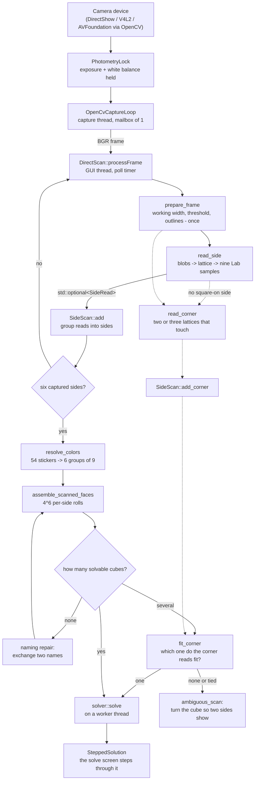

# Vision pipeline

How a camera frame becomes a solved cube. This documents what the code does
**today**: the cube is read one side at a time, from whichever side is held
square to the camera, with no pose tracker and no learned model in the way.

Why it is built this way, and what it replaced, is in
[recovery-plan.md](recovery-plan.md). The short version: the earlier pipelines
tracked the cube's six-degree-of-freedom pose before reading a single sticker,
and a cube looks identical under 24 rotations, so pose alone never says which
side is which. A side is identified here by what is on it.

Source: `src/lib/src/vision/` (platform-free, Qt-free), driven by
`src/app/qt/controllers/direct_scan.cpp` (Qt, GUI thread).

## End-to-end flow

## The reader: `read_side`

`cube::vision::read_side(const cv::Mat& bgr)` returns a `SideRead` or nothing.
It needs a side held roughly square to the camera and relies on darker plastic
between and around the stickers; a side seen at an angle, a lattice that does
not span three rows and three columns, or no cube all return nothing.

1. **Sticker blobs.** `prepare_frame` (`cube/vision/prepared_frame.hpp`)
   reduces the frame to the working width, takes the maximum channel as the
   value image, blurs it, thresholds it adaptively and traces the outlines.
   It is done once per frame and handed to both readers, because it is most
   of what a read costs; contours that are roughly square and roughly
   sticker-sized survive `read_side`'s shape test.
2. **Lattice.** The sticker pitch comes from nearest-neighbour distances and
   the direction from the folded angles. An affine least-squares fit places a
   3x3 lattice through the blobs, and the fit must span all three rows and
   columns. Stickers that were not found as blobs (a finger across one) are
   placed by the fit and flagged in `SideRead::found`.
3. **Colour.** Each of the nine places is sampled as the median of a small
   patch, in float CIELAB.

Nothing in the reader names a colour. It returns measured Lab.

## Sides: `SideScan`

`SideScan::add` is fed every analysed frame, including frames with no read.

- A read **counts** only if the lattice has held still: the centre sticker
  moved less than `kSteadyFraction` (0.12) of a sticker spacing since the
  previous frame. A moving side is blurred and its colours are not trusted.
- A counting read joins the **group** whose fused colours are closest under
  the best quarter-turn roll, if that distance is under the same-side threshold;
  otherwise it starts a new group (`kSameSideDistance`, 12 Lab units; file-local to `direct_scan.cpp`). The distance is `colour_distance`: lightness
  and chroma count for a quarter of what hue does, because shading moves the
  first two and leaves hue alone.
- A group is **captured** once it has `kMinReads` (8) reads, about a third of a
  second of holding still.
- When more than six groups are captured (a stray lattice, a side re-captured
  under changed light) the six with the most reads are used.

## Naming and assembly

Once six sides are captured:

1. `resolve_colors` clusters the 54 Lab samples into six groups of nine,
   seeded from the six centres (a real cube has six distinct centre colours),
   and names each cluster by nearest reference colour. Because the cube's own
   stickers define the clusters, a lighting shift that moves every sample of
   one colour together cancels out.
2. `assemble_scanned_faces` finds the slot for each side from its centre and
   tries the 4,096 roll combinations against `Cube::from_facelets` and
   `is_solvable`. Physical validity is the arbiter, not a score.
3. If the naming does not assemble, the pairs of names are exchanged one pair
   at a time; among the exchanges that do assemble the one whose two centres
   look most alike is taken. This repairs red/orange swaps under tungsten light,
   which colour naming alone cannot get right.

`SideScan::scanned()` also returns what each colour measured in this session
(`SessionColours`), which the solve screen's held-cube matching compares
against.

## Two sides in one view: `read_corner` and `fit_corner`

Six square-on reads say what is on each side but not which way up each is
relative to its neighbours. For about one scrambled cube in eighty (12 of
1000 25-move scrambles) that leaves two valid cubes, and a perfect read still
cannot choose: `assemble_all_scanned_faces` returns both and the scan reports
`ambiguous_scan`, which the screen words differently from a misread.

A cube turned between sides, or held corner-on, shows two sides at once, and
where they meet the stickers along the shared edge are neighbours - the fact
the flat reads lack.

1. **`read_corner`** takes the same prepared outlines with a looser shape test (a side
   at an angle is a parallelogram: a compact four-cornered contour, not a
   square), and finds up to three 3x3 lattices by RANSAC over blob triples,
   each fitted by least squares with its steps turning clockwise so the side
   reads unmirrored. Two lattices share an edge when two corners of each
   coincide; read as seen from outside, they walk that edge in opposite
   directions, which is also a check. It runs only on frames that have no
   square-on read, and gives up on a scene with more than 48 blobs.
2. **`fit_corner`** asks whether a candidate cube could have produced the
   read, in the session's own colours: each lattice's centre names the cube
   side it is; each side's nine colours must match that side under some
   quarter-turn; and for each shared edge the side across the edge, in the
   turn that matched, must be the other lattice's side, with the stickers
   along it paired as the cube has them (checked on 3D sticker positions
   from the solver's own layout, not drawn by hand).
3. **`SideScan`** keeps the newest 48 corner reads. When six sides make
   several cubes it takes the one that most corner reads fit and more than
   any other; a read that fits all of them says nothing and one that fits
   none is a blurred frame. No pose is estimated anywhere in this.

Measured on the recorded sessions with `cube_scan corners`: 6 frames with
two sides in view (the sessions hold sides square-on, so turns are quick);
4 fit the true cube and rule out 17 or 18 of the 18 cubes one turn away, and
the 2 that did not were the narrow ones (a side with only 6 or 7 of its 9
stickers found, at a steep angle). An ambiguous cube drawn
with its corner views is settled to the true cube. Whether a real person
turning a real ambiguous cube produces a read that fits is not measured yet:
no recorded session is one.

## Camera photometry

Colour is only comparable across frames if the camera stops adjusting itself.
`PhotometryLock` (`src/app/platform/detail/photometry_lock.cpp`) holds exposure
and white balance once the camera has settled, and reports what it did; the
scan waits for that report (`kLockWaitFrames`) before counting reads. Notes
from the workstation webcam under DirectShow and OpenCV 4.12:

- White balance in kelvin is `CAP_PROP_WHITE_BALANCE_BLUE_U`;
  `CAP_PROP_WB_TEMPERATURE` does nothing.
- Clearing auto white balance drops the camera to a stored 4000 K preset, so the
  lock reads the auto temperature first, clears auto, writes it back, and checks
  the blue/green ratio, bisecting 2800-6500 K if it did not take.
- A temperature write takes more than twelve frames to show.
- Writing exposure leaves auto exposure; `CAP_PROP_AUTO_EXPOSURE = 1` restores
  it.

A platform that cannot control photometry says so in the report rather than
claiming a lock.

## While the cube is being solved: `HeldCube`

The camera keeps running on the solve screen and is only asked which side is
in view. `fit_holds` compares a read against what each of the 24 ways of
holding the (now known) cube would show, in the session's own colours; the
hold that fits, and that no differently-looking hold fits nearly as well, turns
the on-screen cube to match. This is not tracking: nothing is estimated between
reads and nothing is read at an angle. Nothing is added to the scan while
watching.

## Threading

- **Capture thread** (`OpenCvCaptureLoop`) owns the device and publishes the
  newest frame into a one-deep mailbox. Old frames are dropped, never queued.
- **GUI thread** runs `DirectScan::processFrame`. A read is a few milliseconds,
  well inside the poll interval, so there is no analysis worker and no scan
  state to hand between threads. Only `latestFrame()` is called from elsewhere
  (the preview image provider).
- **Solve** runs once per scan on a `QtConcurrent` worker so the seconds it can
  take never reach the UI thread.

## Known limits

- **Light-bodied and stickerless cubes** read as nothing: the blob step needs
  dark plastic between stickers. The July 2026 corpus is such a cube and reads
  0 of 14.
- **Square-on only.** A side seen at an angle returns nothing, by design.
- **A cube that six flat sides put together two ways** (about one in eighty,
  and any cube one turn from solved) needs a corner view to settle, and the
  corner reader is validated on six real frames and drawn ones only. A side
  seen at a steep angle, or with a finger across it, may not fit; the scan
  keeps asking for more until a read does.
- **Light.** Hard backlit or glare conditions are not proven; the measured
  drift in a sticker can exceed the red/orange gap. The review screen is the
  planned backstop.

## Seeing what the app is reading, live

A scan that misnames a colour, a cube that will not assemble: the running app
can be asked what it is reading and deciding without being restarted. The
[live diagnostics channel](diagnostics.md) writes, as the scan happens, each
captured side's fused nine Lab values with its read count and roll; the six
cluster seeds and means, every sticker's cluster and assignment confidence, the
palette matching, whether the hue names overrode it or fell back on a
collision, and `classify_lab`'s hue and chroma for each mean; which path of the
assembly step was taken (one candidate, several and how the corner reads
chose, a direct failure, or the closest-centre name exchange and which pair);
the camera's photometry lock as the driver accepted it; and the solve and the
held-cube verdicts. It is off by default, switched live from Settings or with
`Ctrl+Shift+D`, and costs a boolean test while off.

The reading code is not logged into. `resolve_colors_explained` and
`SideScan::diagnose` return the working the algorithms already hold as plain
structs (`ColorResolution`, `AssemblyTrace`, `ScanDiagnosis`); `resolve_colors`
and `scanned()` are those with the rest dropped, so the diagnostic and the live
path cannot disagree.

## Scoring and replay

`cube_scan` (`tools/scan`) replays recorded sessions through the same reader:

| Command | Does |
| --- | --- |
| `cube_scan replay <session-dir>` | One session: the cube and its solution |
| `cube_scan board <root-dir>` | Every session under the root, against its `truth.txt` |
| `cube_scan holds <session-dir>` | How the cube was held, frame by frame |
| `cube_scan corners <session-dir>` | Frames showing two sides at once, and whether they fit the true cube |

The only gate is a real recorded session ending in the exact true cube.
`truth.txt` is six words of nine letters from `WYROGB`, one per side, each side
row-major as seen from outside, in any orientation and any order.

Recording is a developer opt-in: the app stores nothing unless
`CUBE_SCAN_RECORD_DIR` names a folder, and then shows a recording marker on the
scan screen. See [recording-format.md](recording-format.md). Recordings can show
the person holding the cube, so they stay outside the repository.
