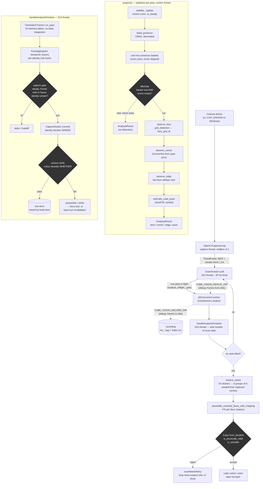

# Vision pipeline

How a camera frame becomes a solved cube state. This documents what the
code does **today**, including the paths that are wired but not yet
load-bearing; where a stage is known-weak the measurement that says so is
cited, because several of these constants were tuned against one cube under
one set of lights and do not generalise as well as their names suggest.

Source: `src/lib/src/vision/` (platform-free, Qt-free), driven by
`src/app/qt/controllers/scan_session.cpp` (Qt, GUI thread + one worker).

## End-to-end flow

## Threading contract

Three threads, and the rules that keep them safe:

- **Capture thread** (`OpenCvCaptureLoop`) owns the device and publishes the
  newest frame into a one-deep mailbox. Old frames are dropped, never
  queued, so analysis latency cannot accumulate.
- **Worker thread** runs `analyze()` and is **stateless by contract** — it
  reads a frame plus by-value hints and returns an `AnalysisResult`. It
  never touches scan state. Exactly one pass is in flight
  (`analysis_inflight_`); the pass is wrapped so a thrown exception cannot
  reach `QFutureWatcher::result()` and terminate the process.
- **GUI thread** runs `poll()` and `handleAnalysisFinished()`, and is the
  **sole mutator** of tracker, aggregators and slot store. Every Q_PROPERTY
  the QML binds emits its NOTIFY signal from here.

## Colour: where the decisions actually happen

This is the part most worth understanding, because the naming is
misleading.

| Decision | Made by | Adapts to your cube/lighting? |
| --- | --- | --- |
| Sticker candidate masks | `kMinStickerSaturation`, `kMinWhiteValue`, `kMinBrightPathValue` | **No** — fixed constants |
| Per-frame sticker colour | `classify_lab` — fixed hue bands, chroma ceiling | **No** — fixed palette |
| Capture verification / routing | `capture_routing` census + centre-Lab radii | **No** — fixed radii |
| Final 54-sticker assignment | `resolve_colors` | **Yes** — seeded from captured centres |

`resolve_colors` is the only component that adapts, and it runs **once, at
scan completion**. Every gate that decides whether a reading is good enough
to commit uses a fixed constant. Its header states the split explicitly:
`classify_lab` is *"used only for live UI display while scanning"*, while
`resolve_colors` is *"the authoritative classification"*.

## Known-weak stages, with the evidence

- **Cell sampling.** Sample patches are placed by projecting the fitted
  grid. When few cells are detected the rest are extrapolated, and
  peripheral patches drift onto neighbouring stickers, the inter-tile
  lattice, or off-face background. Measured: centre cells deviate ~7 Lab
  between readings of one face, edge/corner cells ~18-19; on some clips a
  third of samples fall below L=35, i.e. they are shadow or background
  rather than a sticker.
- **Absolute colour thresholds.** `kWhiteChromaCeiling` and the hue band
  edges were fitted to one cube under one light. Measured on a warm-lit
  webcam scene: white tiles arrived at chroma 15.7-21.0 (above the ceiling,
  so classified by hue into the orange band) while blue arrived at 18-24 —
  overlapping. Under a front light with a neutral backdrop the same cube
  gave blue 35-44 and white 4-14.5, cleanly separated. **The dominant
  colour error is photometric, not algorithmic.**
- **Red/orange separation.** `kClosestCentrePairLab` documents 27.0 as the
  minimum legitimate centre separation; measured on real captures the
  closest pair is 23.1, below the constant that several gates rely on.
- **Camera photometry is uncontrolled.** Nothing sets any `CAP_PROP_*`.
  Auto white balance and auto exposure run free, and per-face mean
  lightness was measured drifting 14-18 points *within a single scan*.

## Debug and replay surfaces

All are env-gated and inert in normal runs.

| Variable / tag | Effect |
| --- | --- |
| `CUBE_VISION_RECORD_DIR` | Write every analysed frame + `index.csv` |
| `CUBE_VISION_REPLAY_DIR` | Feed frames from a recording instead of the camera |
| `CUBE_VISION_DEBUG_DIR` | Per-pass `vision_debug.log` (TRACK/SLOT lines) |
| `CUBE_VISION_AUTOSTART_SCAN` | Begin scanning without UI interaction |
| `[.frame-debug]` | Replay one frame through every stage |
| `[.track-replay]` | Replay a recording through tracker + router |
| `[.cross-session]` | Emit per-face captured colour + registration diagnostics |
| `[.pattern-id]` | Emit per-reading Lab, anchor count, geometry confidence |

Hidden Catch2 tags (leading dot) skip when their corpus is absent, so they
never run in CI.
